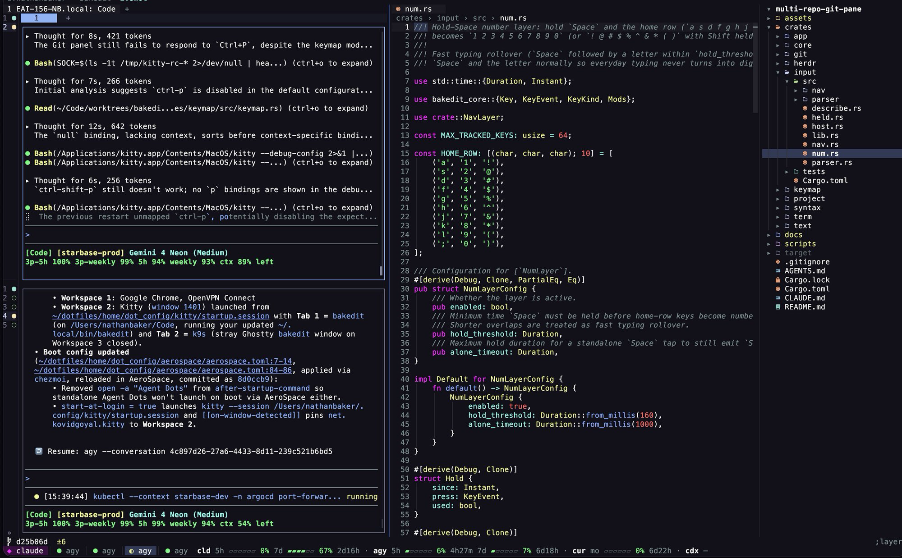
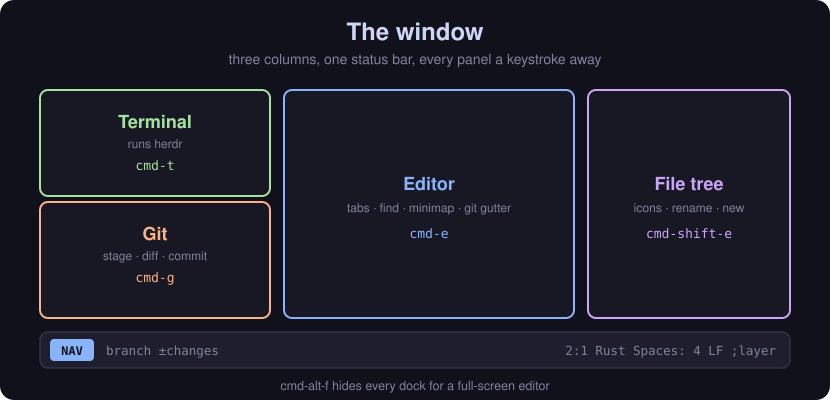
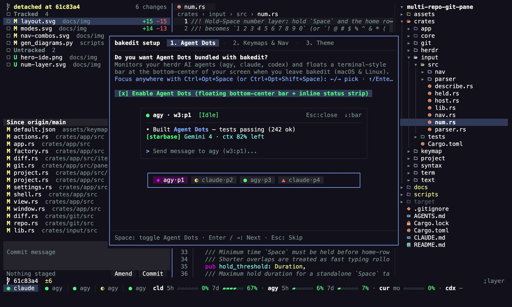
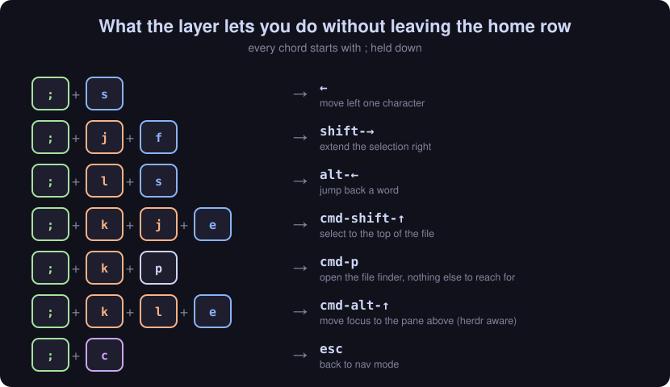
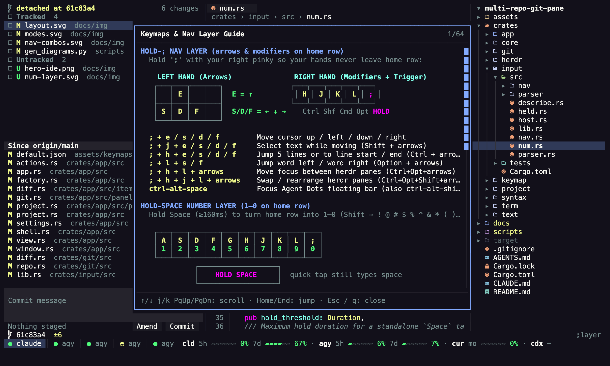
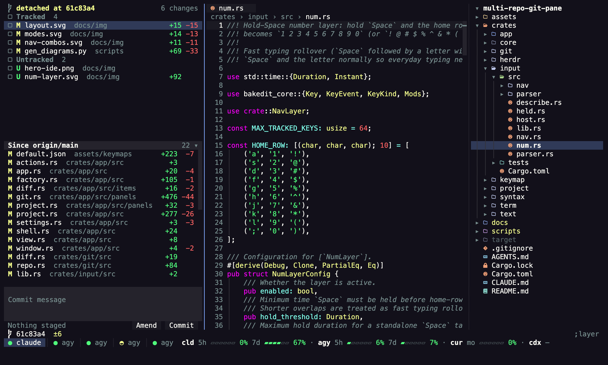
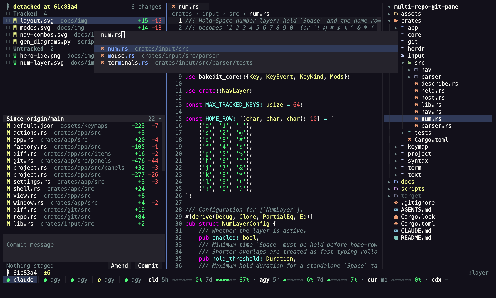

# bakedit

A fast, lean terminal IDE in Rust, built around [herdr](https://github.com/ogulcancelik/herdr),
**Agent Dots**, and two home-row keyboard layers.



## Why

I used Zed for a long time and loved the speed and the keybindings. Then it filled up with AI
features, agent panels, collaboration, extensions and a growing pile of things I never asked
for. I wanted the editor back, and nothing else.

bakedit is that editor. It does not have:

- AI assistants, agent panels or inline completions (your agents run in `herdr`, in a terminal, where they belong)
- collaboration, calls or accounts
- an extension system or a marketplace
- a GUI toolkit, a web view or an Electron shell

It does have the parts I use every day: a rope-based text buffer, tree-sitter highlighting, a
minimap, find and project search, a file tree, a multi-repo split git panel with a project diff,
an embedded `herdr` terminal, **Agent Dots** monitoring, command palette, tab switcher, built-in
themes, an interactive onboarding wizard, and Zed's keymap and `settings.json` semantics so muscle
memory carries over.

## Built around `herdr` & Agent Dots

The terminal panel runs [herdr](https://github.com/ogulcancelik/herdr), a terminal workspace
manager, by default. bakedit speaks directly to its socket, so herdr's panes, workspaces and zoom
are native actions in the editor: `ctrl-alt-arrows` moves focus between herdr panes (hopping to the
next tab or workspace at an edge), `ctrl-alt-shift-arrows` swaps panes, `ctrl-alt-1` to `9` jumps
workspaces, and `ctrl-alt-f` enters herdr copy-mode search.

It is a single Rust binary. Everything runs in your terminal using a portable **`Ctrl` / `Ctrl+Opt`**
keymap that leaves **`Cmd`** untouched for your host terminal (Kitty, Ghostty, cmux, iTerm2) and
works over SSH with zero terminal configuration.



### Agent Dots

When you run AI coding agents (`agy`, `claude`, `codex`) inside `herdr`, **Agent Dots** tracks
their live status (idle, thinking, waiting for input, error) in two places:

- **Inline status strip** at the bottom of `bakedit`, alongside live quota bars.
- **Floating bottom-center pill bar** (`bakedit-dots`) that appears automatically when you switch
  away from your terminal. Hit **`Ctrl+Opt+Space`** from anywhere on macOS/Linux to focus it,
  `←`/`→` to pick an agent, `↑`/`Enter` to reply or jump straight to its pane, and `Esc` to dismiss.



## Home-row keyboard layers

Vim has the right idea: your fingers should stay on the home row. But modal editing only helps
inside the editor. The moment you reach for an arrow key, a number, a modifier, or a shortcut in
any other panel, your hand leaves the keys. bakedit builds two layers directly below every panel.

### 1. Hold `;` — Nav layer (arrows & modifiers)

**Hold `;`** with your right pinky and the home row becomes a navigation & modifier layer:

- `e` `s` `d` `f` are up, left, down, right
- `h` `j` `k` `l` are `ctrl`, `shift`, `cmd`, `alt` — and they stack freely
- `a` is `tab` and `c` is `escape`
- every other key passes through with the layer's modifiers added
- tap `;` on its own and it types `;`


Because the layer's modifiers add to any key, every shortcut in every panel is reachable without
moving off the home row: `; + h + p` is `ctrl-p` (file finder), `; + h + l + e` moves up a `herdr`
pane, and `; + j + f` extends a selection right.



### 2. Hold `Space` — Home-row number layer (`1–0`)

**Hold `Space`** (≥ 160ms) and the home row turns into numbers — no reaching for the top row:

- `a s d f g h j k l ;` → `1 2 3 4 5 6 7 8 9 0`
- With **Shift** → `! @ # $ % ^ & * ( )`
- Fast typing rollover (< 160ms) still types `Space` + letter normally, a quick tap types `Space`,
  and it automatically yields while the `;` nav layer is active.


### NAV (default) & EDIT modes

Under both layers are two simple modes — **NAV is the default** so stray keypresses never corrupt
a file, with no vim letter keys to memorize:


In **NAV** mode, plain text keys and destructive edits (`enter`, `tab`, `backspace`, `delete`) are
ignored while arrows, both home-row layers, and every `Ctrl` / `Alt` shortcut work normally. Press
`Ctrl+Opt+I` to enter **EDIT** mode and `Esc` (or `Ctrl+Opt+I`) to return to **NAV**.

Both keyboard diagrams are always one command away inside `bakedit` via the interactive
**Keymaps & Nav Layer Guide** (`Ctrl+Shift+P` → `bakedit: keymaps guide`):



## Split Git panel & File finder

The Git panel (`Ctrl+G`) auto-discovers every repo in a multi-repo workspace, switches repos as
you move through the file tree, and splits into **Uncommitted** changes on top and **`Since <base>`**
branch changes below — with staging, commit/amend, full project diffs (`Ctrl+Opt+G`), and `Ctrl+C`
to copy the relative path of any file.



Fuzzy file finder (`Ctrl+P`) works from every panel — including the Git panel and file tree:



## Built-in themes & onboarding

First launch walks through a 3-step onboarding modal (**Agent Dots** → **Keymaps & Nav** → **Theme**)
with live previews for the four built-in themes (`Ghostty`, `Terminal`, `Catppuccin Mocha`, and
`Light`). Reopen it anytime from the Command Palette (`bakedit: onboarding` or `bakedit: select theme`).

## Install

You need a recent stable Rust toolchain, `git`, and optionally [herdr](https://github.com/ogulcancelik/herdr)
for the terminal panel.

```sh
git clone https://github.com/nbaker47/bakedit
cd bakedit
cargo build --release
rm -f ~/.local/bin/bakedit && cp target/release/bakedit ~/.local/bin/bakedit
```

```sh
bakedit                      # open the current directory
bakedit src/main.rs:42       # open a file at a line (also :42:7, :42-60, #L42)
bakedit --here               # stay in the current terminal (Kitty, Ghostty, cmux, SSH)
bakedit --terminal shell     # plain shell in the terminal panel instead of herdr
bakedit --probe              # inspect what your terminal supports
bakedit --print-keymap       # dump the built-in keymap
```

When bakedit is already running, files are sent to that window, so it works as a click target for
`path:line` links printed by tools and agents, and as `$EDITOR` (`EDITOR="bakedit --here"` edits
inline in the terminal git runs in).

## Keys

The keymap uses Zed's format and semantics (`assets/keymaps/default.json`, overridden by
`~/.config/bakedit/keymap.json`). All shortcuts use **`Ctrl` / `Ctrl+Opt`** so **`Cmd`** stays
free for your host terminal:

| Key | Does |
|---|---|
| `ctrl-p` | File finder (works from any panel) |
| `ctrl-shift-p` / `ctrl-alt-p` | Command palette |
| `ctrl-l` | Go to line number (negative counts from end) |
| `ctrl-f` / `ctrl-alt-f` | Find in file / Project search (`herdr` search in Terminal) |
| `ctrl-alt-h` | Project search & replace |
| `ctrl-j` / `ctrl-alt-j` | Toggle terminal (`herdr`) / Terminal fullscreen |
| `ctrl-g` / `ctrl-alt-g` | Toggle split Git panel / Project diff fullscreen |
| `ctrl-alt-e` / `ctrl-shift-e` | Focus or reveal file tree (second press collapses) |
| `ctrl-e` | Focus center code editor |
| `ctrl-alt-z` | Hide/show all docks (fullscreen editor) |
| `ctrl-alt-i` / `ctrl-shift-i` | Toggle NAV (default) ↔ EDIT mode (`Esc` → NAV) |
| `ctrl-c` *(in file tree / Git panel)* | Copy relative path (`ctrl-alt-shift-c` for full path) |
| `ctrl-w` / `ctrl-k w` | Close current tab / Close all editor tabs |
| `ctrl-alt-←` / `ctrl-alt-→` | Previous / next open editor tab (`ctrl-{` / `ctrl-}`) |
| `ctrl-k (` `[` `{` `"` `'` | Select between brackets or quotes |
| `ctrl-alt-arrows` | Move focus between `herdr` panes |
| `ctrl-alt-space` | Focus Agent Dots floating bar |
| `ctrl-] ?` | Show all keybindings |

## Built to stay fast

- One Cargo workspace of small crates, each with one job: `input`, `keymap`, `text`, `syntax`,
  `term`, `git`, `project`, `herdr`, and the `app` that wires them together.
- Nothing a view does may block drawing. Git, search, indexing, and syntax run on background
  threads and report back on the next tick.
- Libraries never panic on bad input and never print.
- Over 2,300 tests, including end-to-end PTY scenarios (`scripts/ptyshot.py`) that drive the real
  release binary and assert on the rendered screen.

## Status

Built for my daily workflow first. Issues and pull requests are welcome, though there is no promise
to add features I do not use.

- `AGENTS.md` has the architecture notes and how to build, test, and screenshot it.
- `python3 scripts/gen_diagrams.py` regenerates the SVG keymap & layout diagrams in `docs/img/`.

## Credits

The look and keymap follow [Zed](https://zed.dev), and the terminal workspace is
[herdr](https://github.com/ogulcancelik/herdr).
