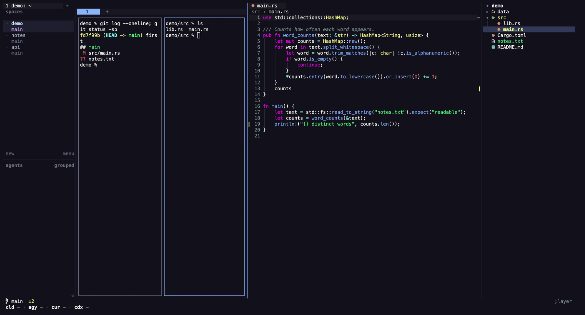
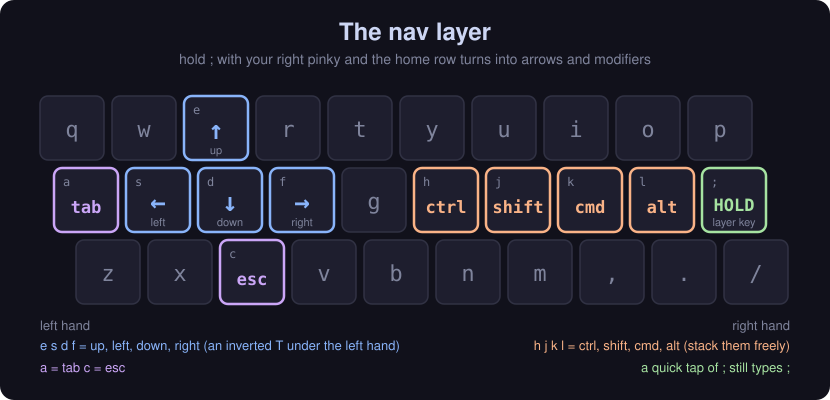
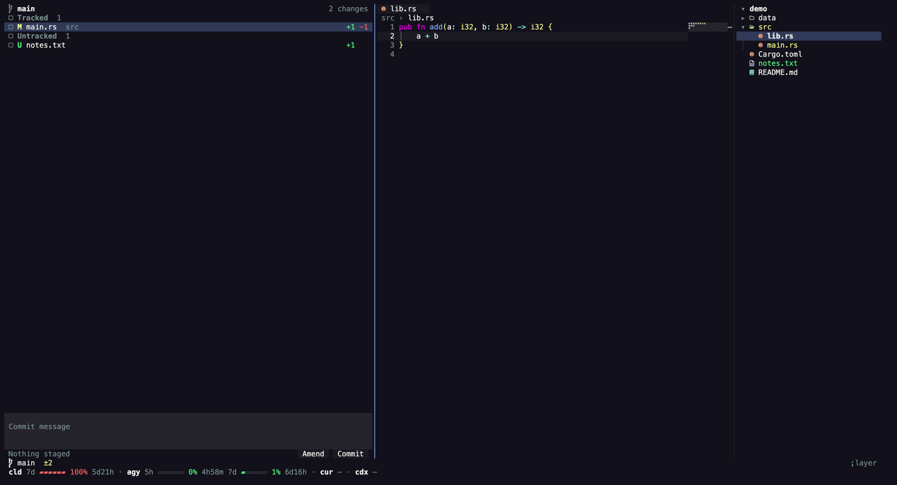

# bakedit

A fast, lean terminal IDE in Rust, built around [herdr](https://github.com/ogulcancelik/herdr)
and a keyboard-first nav layer.


## Why

I used Zed for a long time and loved the speed and the keybindings. Then it filled up with AI
features, agent panels, collaboration, extensions and a growing pile of things I never asked
for. I wanted the editor back, and nothing else.

bakedit is that editor. It does not have:

- AI assistants, agent panels or inline completions (my agents run in herdr, in a terminal, where they belong)
- collaboration, calls or accounts
- an extension system or a marketplace
- a GUI toolkit, a web view or an Electron shell

It does have the parts I use every day: a rope-based text buffer, tree-sitter highlighting, a
minimap, find and project search, a file tree, a git panel with a project diff, an embedded
terminal, command palette, tab switcher, and Zed's keymap and `settings.json` keys so my
muscle memory carries over.

## Built around herdr

The terminal panel runs [herdr](https://github.com/ogulcancelik/herdr), a terminal workspace
manager, by default. bakedit speaks to its socket, so herdr's panes, workspaces and zoom are
native actions in the editor: `cmd-alt-arrows` moves focus between herdr panes (hopping to the
next tab or workspace at an edge), `cmd-alt-1` to `9` jumps workspaces, and
`ctrl-]` gives a prefix that works even where the terminal cannot pass `cmd` through.

The panel above is a real herdr session: its workspace list on the left, two panes split
inside it, and the editor and file tree beside it, all in one window.

It is a single Rust binary. Everything runs in your terminal, so it works over SSH, in
Ghostty, cmux, kitty or anything that speaks the kitty keyboard protocol, and it falls back
gracefully where one does not.




## The nav layer

Vim has the right idea: your fingers should stay on the home row. But modal editing only
helps inside the editor. The moment you reach for an arrow key, a modifier, or a shortcut in
any other panel, your hand leaves the keys.

bakedit builds the fix in. **Hold `;`** and the home row becomes a layer:

- `e` `s` `d` `f` are up, left, down, right
- `h` `j` `k` `l` are ctrl, shift, cmd, alt, and they stack
- `a` is tab and `c` is escape
- every other key passes through with the layer's modifiers added
- tap `;` on its own and it types `;`



Because the layer's modifiers add to any key, every shortcut in every panel is reachable
without moving off the home row. `;` + `k` + `p` is cmd-p. `;` + `k` + `j` + `e` selects to the
top of the file. It works in the editor, the terminal panel, the file tree, the git panel and
every picker, because it lives below all of them.


It is much faster than vim's approach in practice: there is no mode to be in, no mode to
forget you are in, and the same arrows and shortcuts work everywhere. Under the layer is the
usual pair of modes if you want them:


The layer matches the physical key position, not the character, so it stays in place on
other keyboard layouts. It is a built-in version of the Karabiner-Elements rule I used to
run, so it works wherever bakedit runs. Turn it off with `"nav_layer": false` in settings
or the `bakedit::ToggleNavLayer` action. The key assignments live in `NavLayerConfig`
(`crates/input/src/nav.rs`).

## What it looks like

Fuzzy file finder (`cmd-p`):


Project search with include and exclude globs (`cmd-shift-f`):


Git panel with stage, commit and amend (`cmd-g`), and a project diff (`cmd-alt-g`):



## Install

You need a recent stable Rust toolchain, `git`, and optionally [herdr](https://github.com/ogulcancelik/herdr)
for the terminal panel.

```sh
git clone https://github.com/nbaker47/bakedit
cd bakedit
cargo build --release
ln -s "$PWD/target/release/bakedit" ~/.local/bin/bakedit
```

```sh
bakedit                      # open the current directory
bakedit src/main.rs:42       # open a file at a line (also :42:7, :42-60, #L42)
bakedit --here               # in this terminal, not a Ghostty window of its own
bakedit --terminal shell     # plain shell in the terminal panel instead of herdr
bakedit --probe              # what your terminal supports
bakedit --print-keymap       # the built-in keymap
```

On macOS bakedit opens in a dedicated Ghostty window that passes every cmd key through,
and the command returns at once. `--here`, an SSH session, or `"window": false` in
`~/.config/bakedit/settings.json` keep it in the terminal you ran it from; without Ghostty
it stays there and says why.

Ghostty saves its `window-save-state` setting in the preferences your own Ghostty reads
too, and bakedit's window sets it to `never`. Until your Ghostty next loads its config,
quitting it does not keep its windows if you use `window-save-state = always` or have
turned off macOS's "Close windows when quitting an application". `"window": false` avoids
this.

When bakedit is already running, files are sent to that window, so it is the target of
`path:line` links printed by tools and agents. Terminal output links are cmd-clickable
too. It works as `$EDITOR`: started by a program rather than a shell (git, crontab, an
agent's ctrl-g), it opens a window of its own and returns only when that window closes.
`--wait` forces this; `EDITOR="bakedit --here"` edits in the terminal git runs in instead.

## Keys

The keymap is Zed's format and semantics: `assets/keymaps/default.json`, with Zed's action
names where Zed has the action. A few that matter most:

| Key | Does |
|---|---|
| `cmd-p` | file finder |
| `cmd-shift-p` | command palette |
| `cmd-shift-f` | project search |
| `cmd-t` / `cmd-g` / `cmd-shift-e` | terminal / git / file tree |
| `cmd-e` | back to the editor |
| `cmd-alt-f` | hide every dock |
| `ctrl-]` then `?` | show all keybindings |
| `cmd-i` | switch between NAV and EDIT mode |

In NAV mode no plain key types or edits: letters and the other text keys are ignored, and so
are enter, tab, backspace and delete and their ctrl aliases (`ctrl-h`, `ctrl-d`, `ctrl-w`,
`ctrl-k`, `ctrl-y`, `ctrl-t`). Everything else works exactly as in EDIT mode: the arrows, the
`;` layer and shift-arrows move and select, and the cmd and alt shortcuts still do what they
always do, including the ones that edit on purpose (cut, paste, undo, `cmd-backspace`,
`alt-backspace`, `cmd-enter`). There are no vim letter keys.

## Built to stay fast

- One Cargo workspace of small crates, each with one job: `input`, `keymap`, `text`, `syntax`,
  `term`, `git`, `project`, `herdr`, and the `app` that wires them together.
- Nothing a view does may block drawing. Git, search, indexing and syntax run on background
  threads and report back on the next tick.
- Libraries never panic on bad input and never print.
- About 2,300 tests, including scenarios that drive the real release binary through a
  pseudo-terminal and check the screen (`crates/app/tests/scenarios/run.sh`).

## Status

Early, and built for one user's workflow first. It is my daily driver, but expect rough edges
(tree drag and multi-select and hunk staging are not there yet). Issues
and pull requests are welcome, but there is no promise to add features I do not use.

`AGENTS.md` has the architecture notes and how to build, test and screenshot it.
`python3 scripts/gen_diagrams.py` regenerates the SVG diagrams in this README.

## Credits

The look and keymap follow [Zed](https://zed.dev), and the terminal workspace is
[herdr](https://github.com/ogulcancelik/herdr).
